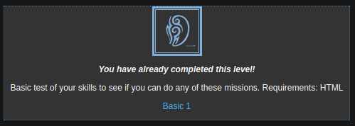
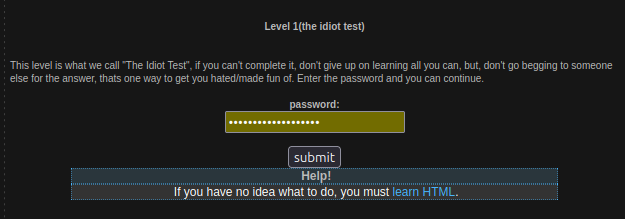
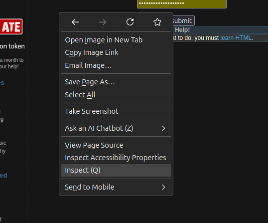
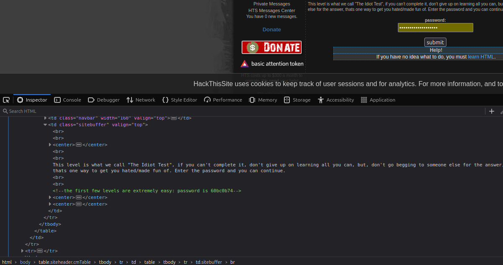
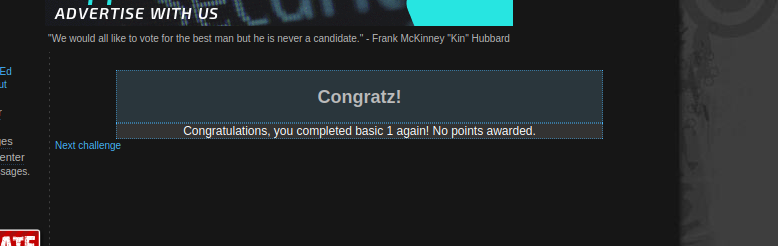

# Basic 1 - The Idiot Test

### Konzepte & Writeup

Mit Basic 1 beginnt das erste Level. Der Hinweis verrät bereits, dass hier HTML-Kenntnisse gefragt sind. Das Level trägt den Namen "The Idiot Test" – anfangs war mir noch nicht ganz klar, warum. 

---

Da HTML (Hypertext Markup Language) die Basis ist, die Webseiten im Browser strukturiert, setze ich genau da an. Ich mache einen Rechtsklick auf die Seite und untersuche den HTML-Quellcode, um zu prüfen, ob sich rund um das Passwortfeld erste Hinweise finden lassen.

---

Beim Öffnen der Entwicklertools springt mir sofort ein grüner HTML-Kommentar ins Auge, der das Passwort direkt im Klartext liefert. 

---

Nun verstehe ich auch, wieso dieses Level "Idiotentest" genannt wird. Ich kopiere das gefundene Passwort, füge es in das Formular ein und sende es ab. Daraufhin wird das Level erfolgreich bestanden.

--- 

## Lessons Learned

Große technische Schlüsse lassen sich aus diesem Level noch nicht ziehen, da es sehr einfach war. Allgemein lässt sich aber festhalten: Wenn man nicht genau weiß, was einen erwartet, sollte man sich immer zuerst einen Überblick verschaffen und in den Code schauen. Manchmal liegt die Antwort einem sprichwörtlich direkt vor der Nase.

