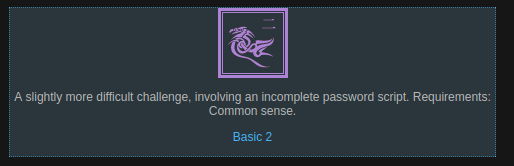
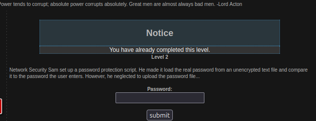
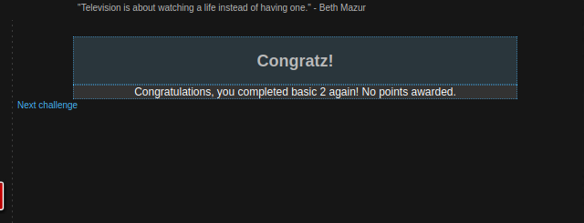

# Basic 2 - Common Sense

### Konzepte & Writeup

Das zweite Level knüpft direkt an die Grundlagen an. Der Hinweis verrät, dass hier gewöhnlicher Menschenverstand ("Common Sense") gefragt ist – anfangs war mir noch nicht ganz klar, warum.

---

Laut der Aufgabenstellung hat Network Security Sam ein Script zur Passwortüberprüfung eingerichtet. Dieses soll das echte Passwort aus einer unverschlüsselten Textdatei laden und mit der Eingabe vergleichen. Allerdings hat er versäumt, die Passwort-Datei überhaupt zu erstellen bzw. hochzuladen.

Anfangs neigt man dazu, viel zu kompliziert zu denken – ich habe kurz sogar darüber nachgedacht, wie ich selbst eine Datei hochladen oder im Code nach versteckten Pfaden suchen könnte. Doch die Antwort lag im Grunde direkt auf der Hand: Da die Passwort-Datei schlichtweg fehlt, existiert auch kein Passwort.

---

Ich habe das Passwortfeld also einfach komplett leer gelassen und das Formular direkt abgeschickt.

**Technischer Hintergrund:** 
Das Script im Hintergrund versucht, den Inhalt der Passwort-Datei einzulesen. Da die Datei nicht existiert, gibt die Abfrage einen leeren Wert (`NULL` bzw. einen leeren String `""`) zurück. Wenn das Passwortfeld im Formular ebenfalls leer abgeschickt wird, vergleicht das Script zwei leere Werte miteinander (`"" == ""`). Die Bedingung ist erfüllt und das System gewährt den Zugriff. Daraufhin wird das Level erfolgreich bestanden.

---

### Lessons Learned

Große technische Hürden gab es auch in diesem Level noch nicht, da der Fehler auf einem Denkfehler des Entwicklers basiert. Allgemein lässt sich aber festhalten: Beim Hacking neigt man oft dazu, Probleme zu verkomplizieren und komplexe Schwachstellen zu vermuten. Manchmal lohnt es sich, die Aufgabenstellung genau zu lesen und den einfachsten, logischsten Weg zuerst auszuprobieren.